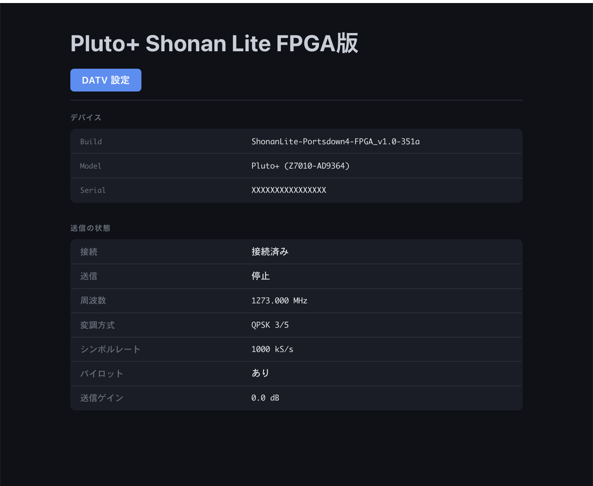
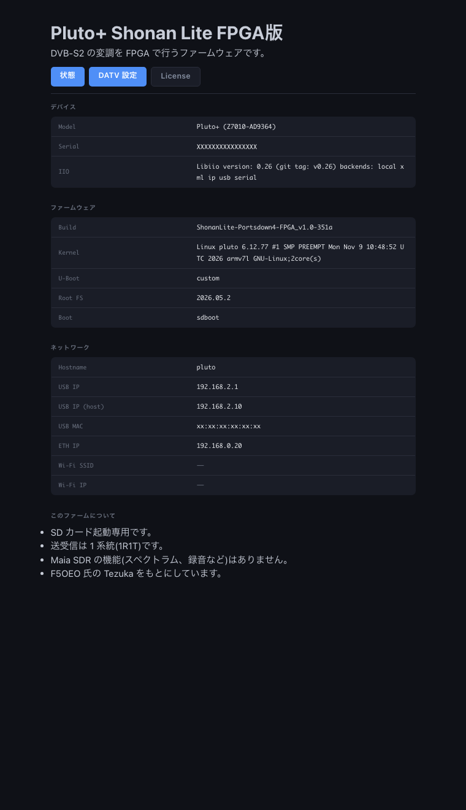

# Pluto+ Shonan_Lite 版(plutoplus_shonan)

**日本語** | [English](#english)

tezuka の Pluto+ 用ファーム(`configs/plutoplus_maiasdr_defconfig`)に、
Shonan_Lite が使う DATV 送信の部品(UDP 専用)([kazushinjo/v0.39-dirty](https://github.com/kazushinjo/v0.39-dirty) の `main` ブランチ、旧 `v0.39-shonan`)を足したもの。
tezuka の機能(maia-sdr、IQEngine、ダッシュボード、MQTT など)はすべて残している。

イメージが QSPI のファーム領域(0x1E00000 = 31,457,280 バイト)に入らないため、**SD カード起動専用**。
`pluto.frm` / `pluto.dfu` は作らない(zip の `flash/` は空)。

## 目次

1. [元にしたもの](#元にしたもの)
2. [ビルド(GitHub Actions)](#ビルドgithub-actions)
3. [SD カードの作り方(Mac)](#sd-カードの作り方mac)
4. [Pluto+ の準備と起動](#pluto-の準備と起動)
5. [起動後の確認](#起動後の確認)
6. [使い方(ポート・URL)](#使い方ポートurl)
7. [SD カードの中身を更新する](#sd-カードの中身を更新する)
8. [足したもの](#足したもの)
9. [datvplutofrm から持ってこなかったもの](#datvplutofrm-から持ってこなかったもの)
10. [リポジトリと CI の注意](#リポジトリと-ci-の注意)
11. [SD 起動しなかった件(2026-10-24)](#sd-起動しなかった件2026-10-24)
11. [ビルド履歴](#ビルド履歴)
12. [未確認](#未確認)
13. [FPGA 版(plutoplus_shonan_dvb)](#fpga-版plutoplus_shonan_dvb)
14. [謝辞](#謝辞)
15. [ライセンス](#ライセンス)

## 元にしたもの

| もの | 版 |
|---|---|
| tezuka_fw(F5OEO) | github.com/F5OEO/tezuka_fw `a304a1f`(v0.3.24、2026-10-17) |
| Buildroot | 2026.05.2(`buildroot.version`) |
| Linux | ADI linux `bf1d49f`(adi-6.12.y)、glibc 2.40、Bootlin ツールチェーン |
| DATV 送信の部品 | [kazushinjo/v0.39-dirty](https://github.com/kazushinjo/v0.39-dirty) `main`(旧 `v0.39-shonan`、build10 = 2649143 と同じ内容) |

Pluto+ は無印 Pluto と同じ Zynq-7010(Cortex-A9 2 コア)・RAM 512MB。FPGA とデバイスツリーは機種専用だが、
ARM 側の実行ファイルは共通なので `pluto_dvb` と `tsp` はビルド済みのものをそのまま使っている
(必要なライブラリ libiio.so.0(0.26)・libstdc++ などは tezuka 側に全部ある)。

## ビルド(GitHub Actions)

Mac ではビルドできない(Buildroot は x86_64 Linux が必要)。GitHub Actions で作る。

```
gh workflow run main.yml --repo kazushinjo/plutoplus_fw-shonan --ref main -f boards=plutoplus_shonan
gh run list --repo kazushinjo/plutoplus_fw-shonan --workflow main.yml --limit 3
```

- できた zip はプレリリース `plutoplus_shonan-build<実行番号>` に付く(Artifacts は容量上限のため当てにしない)。
- 所要時間: キャッシュの無い初回で約 2 時間 40 分(U-Boot 36 分・カーネル 46 分・rootfs 68 分)。
  2 回目からはキャッシュが効く。非公開だったときは Actions の無料枠(月 2000 分)を使っていた。
- Linux 機で手元ビルドする場合:

```
./getbuildroot.sh
./build.sh plutoplus_shonan
```

できたものは `build/plutoplus_shonan.zip`。

## SD カードの作り方(Mac)

使った SD カード: 32GB(31.0GB と表示)。32GB 以下・FAT32 にする。

1. プレリリースから zip を取ってきて展開する

   ```
   gh release download plutoplus_shonan-build2 --repo kazushinjo/plutoplus_fw-shonan --dir ~/Downloads/plutoplus
   cd ~/Downloads/plutoplus && unzip plutoplus_shonan.zip
   ```

2. SD カードを挿し、ディスク番号を確かめる(**間違えると別のディスクを消すので必ず確認**)

   ```
   diskutil list external physical
   ```

   外付け・取り外し可能・容量が SD カードと同じもの(例: `/dev/disk4`、31.0 GB)。

3. MBR・FAT32 で初期化する(中身は全部消える)

   ```
   diskutil eraseDisk FAT32 PLUTOPLUS MBRFormat /dev/disk4
   ```

4. `sdimg/` の**中身**を SD カードの一番上にコピーする(`sdimg` フォルダごとではない)

   ```
   mdutil -i off /Volumes/PLUTOPLUS
   COPYFILE_DISABLE=1 cp -R sdimg/ /Volumes/PLUTOPLUS/
   dot_clean -m /Volumes/PLUTOPLUS
   ```

   SD カードの一番上がこうなっていればよい:

   | ファイル | 中身 |
   |---|---|
   | `BOOT.bin` | **tezuka 0.2.4 の BOOT.bin**(FSBL + 0.2.4 のビットストリーム + U-Boot 2016.07)。今の tezuka の U-Boot 2025.01 はこの Pluto+ で SD 起動しないため(下の「SD 起動しなかった件」) |
   | `system_top.bin` | FPGA ビットストリーム(U-Boot が読み込む。`tezuka_top.bin` は同じもの、`system_top_top.bin` は別の候補) |
   | `uImage` | Linux カーネル(**無圧縮**。U-Boot 2016.07 が LZMA を開けないため) |
   | `uramdisk.image.xz` | rootfs(起動時に RAM へ展開) |
   | `devicetree.dtb` | Pluto+ のデバイスツリー(model「Pluto+ (Z7010/AD9363)」) |
   | `uEnv.txt` | U-Boot の設定 |

   macOS が作る `.fseventsd`・`.Spotlight-V100` は消せないことがあるが、起動には影響しない。

5. 照合して取り出す

   ```
   for f in BOOT.bin devicetree.dtb system_top.bin uEnv.txt uImage uramdisk.image.xz; do
     [ "$(md5 -q sdimg/$f)" = "$(md5 -q /Volumes/PLUTOPLUS/$f)" ] && echo "一致 $f" || echo "不一致 $f"
   done
   diskutil eject /dev/disk4
   ```

## Pluto+ の準備と起動

1. 電源とケーブルを全部外し、上ぶたのネジ 4 本を外す
2. ジャンパを設定する(ジャンパの位置は基板のシルク参照、IO は 1.8V)

   | ジャンパ | 設定 | 理由 |
   |---|---|---|
   | SD-H | **1V8** または **3V3** に接続(基板のシルクにある方。この Pluto+ は **3V3**) | SD カードから起動する。修理記事では v1 基板は 1.8V |
   | URST | **MIO46** に接続 | 内蔵 LAN(ギガビット)を使う。MIO52 は ADI 公式ファーム用 |
   | EXCLK | 外部基準クロックを使うときだけ GND | 普段は外す |

3. SD カードを挿し、電源を入れる(5V 2A 以上、micro USB)
4. LED: 緑と青が点けば FPGA まで進んでいる(青は FPGA の DONE)。20〜40 秒で Linux が起動し、USB ドライブ(`TEZUKA`)が出る。
   **緑だけが点きっぱなし(青が消えている)なら起動失敗**(FSBL か U-Boot で止まっている。SD カードの中身・ジャンパを見直す)
5. 元のファーム(内蔵フラッシュ)に戻すときは SD-H のジャンパを外す

## 起動後の確認

| 確認 | 方法 | 期待する結果 |
|---|---|---|
| ネットワーク | LAN(DHCP)または USB(Pluto 側 192.168.2.1、PC 側 192.168.2.10) | ping が返る。LAN の IP はルーターで確認。mDNS では `pluto.local` |
| DATV の Web 画面 | `http://<IP>/pluto.php` | Controller 画面が出る |
| tezuka のダッシュボード | `http://<IP>/` | maia-sdr / Tezuka Dashboard が出る(lighttpd 経由) |
| SSH | `ssh root@<IP>`(パスワード analog) | ログイン表示に `Version ShonanLite-Portsdown4_v1.0-…`・`Shonan_Lite / Portsdown 4 edition for Pluto+`・`v1.0-ShonanLite-Portsdown4-…` の行(build5 までは `v6822-shonan` など) |
| iio | `iio_info -u ip:<IP>` | ad9361-phy などが見える |
| 版 | `cat /opt/VERSIONS` | `device-fw ShonanLite-Portsdown4_v1.0-<コミット>`、`base tezuka-<コミット>`、`buildroot 2026.05.2`(build5 までは `device-fw tezuka-…`) |

LAN の固定 IP は tezuka の仕組み(USB ドライブの `config.txt` の `[USB_ETHERNET] ipaddr_eth` / `fw_setenv ipaddr_eth`)で設定する。

### 設定についての注意

- 設定(u-boot の環境変数)は **内蔵フラッシュ(QSPI)に保存**される。SD 起動でも内蔵フラッシュのファームと同じ設定を使う。
  `fw_setenv` や USB ドライブの `config.txt`(書き換えてドライブを取り出すと保存、`SUCCESS_ENV_UPDATE` が出る)で変える
- **USB ネットワーク**: 内蔵フラッシュに `usb_ethernet_mode = rndis` が入っていると、このビルドの既定(NCM)より優先される。
  Mac で使うには `config.txt` の `usb_ethernet_mode = ncm` にして取り出し、再起動する(この Pluto+ は 2026-10-24 に ncm に変更済み)
- **周波数範囲**: 内蔵フラッシュの 0.2.4 の設定は `attr_val=ad9363a`。tezuka のカーネルは ad9363a のままでも 46.875MHz〜6GHz を受け付けたが、
  今までの Pluto と同じにするため `fw_setenv attr_val ad9364`(`attr_name=compatible`)にして再起動した。
  起動ログが `ad9361_probe : enter (ad9364)` になる。`mode=1r1t`(受信 1・送信 1)
- **起動直後の UDP 8282**: `settings.txt` が無い間は udpts.sh が空の設定で待つ(datvplutofrm v0.39 と同じ)。
  Shonan_Lite から設定を保存(save.php)すると待ち受けを始める
- **SSH のホスト鍵**: build2 では ed25519・rsa の鍵が内蔵フラッシュに保存されず、再起動のたびに変わっていた
  (下の「SD 起動しなかった件」の後の修正を参照)。この Pluto+ では 2026-10-24 に手で 3 種類とも保存済み

## 使い方(ポート・URL)

| ポート / URL | 使うもの | 中身 |
|---|---|---|
| UDP 8282 | Shonan_Lite 全版 | TS を受けて tsp → pluto_dvb で送信(設定は `/www/settings.txt`) |
| `http://<IP>/save.php`・`/pluto.php` | Shonan_Lite | 送信設定の保存・再起動(lighttpd + php-cgi) |
| iiod(TCP 30431) | Shonan_Lite の受信・RSSI、Langstone | libiio |
| SSH 22 | Shonan_Lite | root / analog |
| `http://<IP>/`(80) | ブラウザ | tezuka ダッシュボード(maia-httpd 127.0.0.1:8000 へ中継、WebSocket も) |
| 443 | ブラウザ | maia-httpd の HTTPS(tezuka のまま) |
| MQTT 1883 / WebSocket 9001 | tezuka ダッシュボード | mosquitto(tezuka のまま) |

USB ネットワークは CDC-NCM が既定(macOS・Windows 10 2004 以降はドライバ不要)。
RNDIS にしたいときは `fw_setenv usb_ethernet_mode rndis` して再起動。

## SD カードの中身を更新する

起動中の Pluto+ では SD カードの FAT 領域が `/boot` にマウントされているので、カードを抜かずに更新できる。

```
scp sdimg/{BOOT.bin,uImage,uramdisk.image.xz,devicetree.dtb,uEnv.txt,system_top.bin} root@<IP>:/boot/
ssh root@<IP> "sync; reboot"
```

## 版の名前

tezuka の正式版と間違えないよう、build6 から独自の名前にしている(`post-build.sh`)。

| 版 | 名前の例 |
|---|---|
| plutoplus_shonan | `ShonanLite-Portsdown4_v1.0-e019` |
| plutoplus_shonan_dvb(FPGA 版) | `plutoplus-udp-fpga-firm_v1.0-e019` |

- `v1.0` は `board/tezuka/shonan/VERSION` の数字。版を上げるときはこのファイルを書き換える。最後はこのリポジトリのコミット番号(4 桁)
- 出る場所: `/opt/VERSIONS` の `device-fw`、USB ドライブの `info.html` の Build、iiod の `fw_version`(Shonan_Lite の「Pluto 情報」・tezuka ダッシュボード)、
  SSH のログイン表示、U-Boot の起動表示(シリアル)
- 元にした tezuka の版は `board/tezuka/shonan/TEZUKA_BASE`(今は `tezuka-v0.3.24-a304a1f`)に書いておき、`/opt/VERSIONS` の `base` とログイン表示の `(base …)` に出す。
  本家 tezuka を取り込んだら、このファイルも書き換える
- USB ドライブの名前(`TEZUKA`)とログイン表示の tezuka のロゴ・「By F5OEO and contributors」は、元の作者の表示としてそのまま

## 足したもの

| 部品 | 内容 |
|---|---|
| `overlay/root/pluto_dvb`, `udpts.sh`, `rtmppluto.sh` ほか | UDP 8282 → tsp → pluto_dvb、rtmp 7272 → ffmpeg → tsp → pluto_dvb(datvplutofrm と同じもの。pluto_dvb と tsp はビルド済みの実行ファイル) |
| `overlay/usr/bin/tsp`, `overlay/usr/lib/ts*` | TSDuck(プラグインは ip・file・sdt・analyze・pcrextract の 5 個) |
| `overlay/www/` | save.php・pluto.php など DATV の Web 画面 |
| `overlay/etc/lighttpd/lighttpd.conf` | ポート 80。DATV の PHP ページと `img/`・`lib/` などだけ自分で返し、それ以外は maia-httpd(127.0.0.1:8000)へ中継する(WebSocket も) |
| `overlay/etc/php.ini` | datvplutofrm と同じ(`cgi.force_redirect = 0`、`post_max_size = 30M`) |
| `overlay/etc/init.d/S90datv` | 起動時に udpts.sh・rtmppluto.sh・watchudp.sh を起動 |
| `overlay/etc/init.d/S89patchfirm`, `overlay/usr/sbin/device_persistent_keys` | SSH のホスト鍵(ecdsa・ed25519・rsa)を起動時に作って保存する。電源断の後も鍵が変わらない。`/mnt/jffs2/patch.zip` があれば展開 |
| `post-build.sh` | maia-httpd を 127.0.0.1:8000 へ移す、USB ネットワークの既定を NCM にする、ログイン表示に `v…-shonan` 行、fwversion.txt・releasenote.txt 作成 |
| defconfig | lighttpd(pcre)、PHP 8.5(cgi・cli・session・sockets)、bc、ffmpeg 6.1.5(datvplutofrm v0.39-shonan と同じ最小構成)。ホスト名は Langstone の既定に合わせて `pluto`。`postimage-qspi.sh` を外し SD カード用だけ作る |
| `.github/workflows/main.yml` | 手動ビルドで zip をプレリリースに付ける、非公開リポジトリのときは attest を飛ばし Artifacts の保存失敗で止まらない |

## datvplutofrm から持ってこなかったもの

- S94pluto-mods(70〜6000MHz 化・2 コア化): tezuka の Pluto+ はデバイスツリーが最初から `adi,ad9361`、`maxcpus=2` なので不要
- S45msd の修正: tezuka の S45msd は `/www` を USB ドライブへコピーしないので不要
- busybox httpd の設定、readsettings.sh(OpenWebRX 用)、motd、wpa_supplicant: tezuka 側のものを使う

## リポジトリと CI の注意

- リポジトリ: kazushinjo/plutoplus_fw-shonan(公開)。ブランチは `main` だけ(2026-11-11 に `shonan` を `main` にした。元の tezuka は [F5OEO/tezuka_fw](https://github.com/F5OEO/tezuka_fw))。
  手元の作業場所は `~/AppDev/tezuka_fw-shonan`(remote: `origin` = このリポジトリ、`upstream` = F5OEO/tezuka_fw)。
- tezuka のタグ(`v0.3.x`)は push しない。タグを push すると全機種のリリースビルドが動く。
  そのため版の表示はタグでなくコミット番号になる(例: `v6822-shonan`)。
- GitHub は、履歴ごとまとめて push した最初の分からはワークフローを登録しなかった。
  `main.yml` を変更するコミットを push したら登録された。
- Artifacts の容量が上限(Artifact storage quota has been hit)のため、zip はプレリリースで受け取る。
- tezuka の CLAUDE.md に合わせ、コミットメッセージは ASCII のみ。
- FPGA 版の HDL は別の公開リポジトリ [kazushinjo/Plutoplus-FPGA-firm](https://github.com/kazushinjo/Plutoplus-FPGA-firm)(Actions は無効)。詳しくは「FPGA 版」の節。
- tezuka 本家の更新を取り込むとき: `git fetch upstream && git merge upstream/main`(shonan ブランチで)

## SD 起動しなかった件(2026-10-24)

### 症状

build2 の SD カード(SD-H=3V3)で電源を入れると、**緑 LED だけが点きっぱなし**(青が点かない)で、Mac に USB 機器が何も出なかった。
SD-H を外すと内蔵フラッシュ(tezuka 0.2.4)は今までどおり起動した(ケーブル・基板は正常)。

### 切り分け

| 試したこと | 結果 | 分かったこと |
|---|---|---|
| 本家 tezuka 0.2.4 の `plutoplus.zip` の `sdimg/` を SD に | **起動した** | 基板・SD-H=3V3・SD カード(32GB、MBR/FAT32)は問題ない |
| build2 の BOOT.bin と本家 v0.3.24 の BOOT.bin を比較 | 版の文字の 8 バイトだけ違う | 本家の最新版もこの Pluto+ では SD 起動しない見込み |
| 0.2.4 の BOOT.bin + build2 の残り | 緑と青(FPGA まで)。USB は出ない | 0.2.4 の FSBL・U-Boot は動く。Linux まで行かない |
| FSBL を 0.2.4 時代(3355a86)に戻してビルド(ブランチ test-oldfsbl、build4) | 書き込み前に中身を比較して不要と判断 | 新旧 fsbl.elf の**書き込まれる中身は同じ**(違いは ELF の付属情報だけ)。FSBL は原因でない |
| U-Boot の版 | 0.2.4 は **U-Boot 2016.07**、今の tezuka は **U-Boot 2025.01** | 新しい U-Boot がこの基板の SD 起動で動かない(シリアルが無いので詳しい原因は未確認) |
| カーネルの形式 | 0.2.4 は無圧縮(zImage)、今は **LZMA 圧縮**の uImage | 0.2.4 の U-Boot は LZMA を開けない(3 行目で Linux まで行かなかった理由) |
| **0.2.4 の BOOT.bin + build2 のカーネルを無圧縮の uImage に作り直したもの + build2 の残り** | **起動した** | 版 `tezuka-6822`・`v6822-shonan`、全プロセスと全ポート、pluto.php・ダッシュボードを確認 |

### 対処(ビルドに反映)

- `postimage-legacy-sd.sh`(新規、両方の defconfig の post-image に追加): SD 用の BOOT.bin を `legacy-boot/plutoplus-0.2.4-BOOT.bin` にし、
  カーネルを無圧縮の uImage(load/entry 0x8000)にする。`overclock/`(新しい U-Boot 入り)は作らない
- 0.2.4 の U-Boot は SD の `uEnv.txt`(このビルドのもの)を読み込み、このビルドのビットストリーム・デバイスツリー・ramdisk で起動する
- `device_persistent_keys`: 保存済みの `keys.md5`(ecdsa だけ)に対する `md5sum -c` が通ってしまい、ed25519・rsa が保存されていなかった。
  3 種類の鍵の md5 一式を比べるように直した
- CI: 出力キャッシュを使うと `images/system_top.bit` が無くて BOOT.bin が作れなかった(postimage-sd.sh が古い `system_top.xsa` の処理で
  同じ名前のファイルを消すため)。イメージ組み立ての前に `board-fpga-reinstall` するようにした

## ビルド履歴

| 版 | コミット | 日付 | 結果 |
|---|---|---|---|
| plutoplus_shonan-build2 | 6822(shonan) | 2026-10-24 | ビルド成功(2h39m、zip 33.5MB、uramdisk 26MB)。**そのままでは SD 起動しない**(U-Boot 2025.01)。0.2.4 の BOOT.bin と無圧縮カーネルに手で入れ替えて起動・動作確認(上の「SD 起動しなかった件」) |
| plutoplus_shonan-build4 | test-oldfsbl | 2026-10-24 | FSBL を戻した試験。FSBL は原因でないと分かったので使っていない(ブランチは削除) |
| plutoplus_shonan-build5 | e0191b1(shonan) | 2026-10-24 | SD 用 BOOT.bin が 0.2.4 のもの(md5 a6ce0ad4…)・カーネル無圧縮(0x8000)・overclock なし・鍵保存の修正入りを確認。版の表示はまだ `tezuka-e019`。実機は未書込み |
| plutoplus_shonan-build6 | 8c48a34(shonan) | 2026-10-28 | 版の名前 `ShonanLite-Portsdown4_v1.0-8c48` を確認。`base` が `tezuka-8c48`(このリポジトリのコミット)になっていたので TEZUKA_BASE で直した |
| plutoplus_shonan-build7 | f953bfa(shonan) | 2026-10-28 | `device-fw ShonanLite-Portsdown4_v1.0-f953`・`base tezuka-v0.3.24-a304a1f`・ログイン表示・U-Boot の表示を確認。BOOT.bin は 0.2.4(md5 一致)。実機は未書込み |
| plutoplus_shonan_dvb-build10 | ea42271(shonan) | 2026-11-09 | RRC ×4 版。起動と DVB-S2 送信(4 方式のヘッダー解読)を確認。同じ Pluto での受信はできない(送信 4 倍・受信 2 倍の衝突) |
| plutoplus_shonan_dvb-build11 | 260031c(rrc-x2) | 2026-11-09 | RRC ×2 版。元のアプリで 500 kS/s のロックを確認。TS がエンコーダへ届かないことがある |
| plutoplus_shonan_dvb-build12 | 4c85fb3(rrc-x2) | 2026-11-09 | Actions のキャッシュで pluto_stream の修正が入らなかった。使わない |
| plutoplus_shonan_dvb-build13 | 692f70e(rrc-x2) | 2026-11-09 | TS 入力のソケットの修正入り。映像が出るまで数分かかる |
| plutoplus_shonan_dvb-build14 | 33b829d(rrc-x2) | 2026-11-09 | tsp のバッファ修正入り。500 / 1000 kS/s で映像を確認(約 3 秒)。起動直後の最初の送信は DVB-S2 にならない |
| plutoplus_shonan_dvb-build15 | 351ae2b(rrc-x2) | 2026-11-09 | 起動直後の設定の送り直しと、状態ページの CSS の修正入り。実機確認中 |
| plutoplus_shonan_dvb-build16 | 7da2d5e(main) | 2026-11-11 | build15 の版名を `ShonanLite-FPGA_v1.0-7da2` に変えたもの(ビットストリーム・BOOT.bin は同じ)。Plutoplus-FPGA-firm のリリースにも掲載 |

## 未確認

- 実機での送信(Shonan_Lite から)。起動・Web(pluto.php・pluto_temp.php・ダッシュボードの表示)・iiod・SSH は確認済み
- lighttpd 経由での tezuka ダッシュボードの WebSocket(ウォーターフォールなど)
- U-Boot 2025.01 が SD 起動しない詳しい原因(シリアルコンソールで確認したい)
- maia-sdr の受信と pluto_dvb の送信を同時に使ったときの動き
- Pluto+ の PTT(GPIO0/MIO0)と、requests.php の PTT ボタン(AD9361 の GPO を操作する)の対応

## FPGA 版(plutoplus_shonan_dvb)

DVB-S2 の変調を ARM のソフト(pluto_dvb)ではなく **FPGA の DVB-S2 送信回路**で行う版。
Pluto+ の 7010 には Maia-SDR と DVB-S2 送信回路の両方は入らないので、**Maia-SDR を外して**いる。

> 作る手順(Vivado の準備 → FPGA のビルド → ファーム → SD カード → 実機確認)は [FPGA作成.md](FPGA作成.md) に通しでまとめてある。

| 項目 | plutoplus_shonan | plutoplus_shonan_dvb |
|---|---|---|
| FPGA | tezuka 本家の plutoplus(Maia-SDR 入り、2R2T) | plutoplus_dvb(DVB-S2 エンコーダ + RRC ×2 + TX FIR ×8、1R1T、Maia-SDR なし) |
| DATV の変調 | ARM のソフト(pluto_dvb) | FPGA(pluto_stream が操作) |
| Maia-SDR・IQEngine・ウォーターフォール | あり | なし |
| トップページ(`http://<IP>/`) | tezuka ダッシュボード(maia-httpd 経由) | FPGA 版専用の状態ページ(版名・シリアル・送信の状態)。`info.html` も FPGA 版用 |
| Shonan_Lite(UDP 8282)・iiod・SSH | 使える | 使える(同じ URL・ポート) |

### なぜ Maia-SDR を外すか

- tezuka 本家では、FPGA の DVB-S2 送信回路(`dvbs2_encoder_wrapper`)は 7020 の機種(E200・E310・LibreSDR・Fishball 7020・
  PlutoSky R2・SignalSDR Pro)にしか入っていない。Pluto+ と無印 Pluto(7010)のビットストリームには無い
  (各機種の `bitstream/tezuka.xsa` の中の hwh で確認)
- 7010 の資源は LUT 17,600 / DSP 80 / BRAM36 60。F5OEO の実測(tezuka_fw `doc/fpga_usage.md`、plutoskyr2)では
  全部入りで LUT 23,005・DSP 106。DDS を外し 1R1T にして LUT 17,388・DSP 88 まで減らしても DSP が上限を超える
- さらに Maia-SDR(LUT 3,414・DSP 18・BRAM36 21 + BRAM18 16)を外すと、LUT 約 14,000・DSP 約 70・BRAM36 約 27 の見込みで収まる
  (見積もり。実際の値は Vivado のレポートで確かめる)

### FPGA の設計(HDL)

- リポジトリ: **kazushinjo/Plutoplus-FPGA-firm**(公開)、ブランチ `main`(RRC ×2。2026-11-11 に `rrc-x2` を統合)。機能の一覧は `hdl/projects/plutoplus_dvb/fpga.md`
  - 元: F5OEO/maia-sdr の `refactor` ブランチ `5f28808`(2026-10-20)。tezuka 用の FPGA プロジェクト(元は `maia-hdl/projects/tezuka`)が入っている
  - 変更: `6f37fcd`(plutoplus_dvb の追加)、`95c0f68`(手順書 `hdl/projects/plutoplus_dvb/PLUTOPLUS_DVB.md`)、`da82dc5`(plutoplus_dvb に使うファイルだけに整理。整理前はブランチ `backup/before-cleanup-20261028`)、`3e2bed7`・`bf8b7c0`(名前から maia・tezuka を外す: `hdl/`・`projects/plutoplus_dvb`・`dma.tcl`、できるファイルは `plutoplus_dvb.xsa`)
  - 手元の作業場所: `~/AppDev/Plutoplus-FPGA-firm`(remote: `origin` = このリポジトリ、`upstream` = F5OEO/maia-sdr)
  - 元の maia-sdr の GitHub Actions(maia-hdl・maia-httpd など)が push で動いたので、全部取り消し、このリポジトリの Actions は無効にした
- プロジェクト `plutoplus_dvb`(`hdl/projects/plutoplus_dvb/system_bd.tcl`): `mode1r1t`・`txfir`・`dvb`

| ファイル | 変更 |
|---|---|
| `plutoplus_dvb/system_bd.tcl` | `plutoplus_dvb` の設定。Maia-SDR の経路に依存する maia.tcl・maiafirtoiq.tcl・sweeper.tcl・cs12_cs8.tcl は読まない(整理でファイルごと削除) |
| `plutoplus_dvb/system_project.tcl` | `plutoplus_dvb` のデバイス `xc7z010clg400-1` |
| `common/dma.tcl`(新規) | ADC/DAC の DMA を HP2 へ(元は maia.tcl がしていたこと)、HP1 を無効に |
| `common/xilinx_ad9361.tcl` | `mode1r1t` のとき `MODE_1R1T 1`(F5OEO が plutoskyr2 で試した変更と同じ考え方。refactor ブランチには未反映だった) |
| `plutoplus_dvb/Makefile` | 既定のプロジェクトを `plutoplus_dvb` に。Maia-SDR の IP 生成(Python/Amaranth・Yosys)はしない |
| `boards/plutoplus_dvb/` | tezuka の `boards/plutoplus/` と同じ内容(基板は同じ) |
| `plutoplus_dvb/build_plutoplus_dvb.sh` | Linux 用のビルドスクリプト。サブモジュール(adi-hdl・dvb_fpga とその third_party)の取得 → dvb_fpga に `hdl/patches/dvb_fpga` の修正 2 つを当てる → `make plutoplus_dvb.sdk/system_top.xsa` → `make install`(`plutoplus_dvb.xsa`)、レポートをコピー |

- DVB-S2 送信回路は `hdl/dvb_fpga` サブモジュール(OpenResearchInstitute/dvb_fpga、CERN-OHL-W v2)
- FPGA 側の DVB 回路のつながり(`common/dvb.tcl`): DAC DMA → switchsrc → エンコーダ → switchfir → RRC ×2 → switchdest → upack → AD9361。
  スイッチ・エンコーダのレジスタ(0x43C01000〜0x43C10000)は pluto_stream が `/dev/mem` で直接操作する(デバイスツリーの追加は不要)
- このスイッチは起動直後どこにもつながっていないため、FPGA 版ではソフトの pluto_dvb(DMA で IQ を送る)では電波が出ない。
  そのため送信は pluto_stream 経由にした(下の「仕組み」)

### 仕組み

- `/root/pluto_dvb` を差し替えスクリプト(`overlay_dvb/root/pluto_dvb.fpga`)にした。udpts.sh・rtmppluto.sh は変えていない
  - 同じオプション(`-m -c -s -f -t -g -p -v -i`)を受け取り、MQTT で設定を送る
    - pluto_stream へ: `cmd/pluto/<call>/tx/stream/mode`(dvbs2-ts / dvbs)、`tx/dvbs2/constel`・`fec`・`frame`・`pilots`・`sr`、
      `tx/dvbs2/tssourceaddress`(127.0.0.1:1314)、`tx/stream/run`
    - pluto_mqtt_ctrl へ: `tx/frequency`(Hz)、`tx/gain`、`tx/mute`
    - `<call>` は `fw_printenv call`(無ければ `nocall`)。pluto_stream と同じ決め方
  - **最初の TS パケットが届いてから**設定と送信開始を送る(起動直後に電波を出さない)。入力が終わると `tx/mute 1`
  - TS は `tsp -r --buffer-size-mb 0.01 … -O ip 127.0.0.1:1314` で pluto_stream の UDP 入力へ(既定のバッファだと、埋まるまで数分送られない)
  - 起動直後は pluto_stream が命令を受け取れないことがあるので、`tx/stream/mode` が反映されるまで設定を送り直す(最大 5 回)
  - `-d`(TS レートの計算)は元のソフト版(`/root/pluto_dvb.sw`)が答える
  - ロールオフ(`-r`)は FPGA 側で変えられないので無視
- pluto_stream・pluto_mqtt_ctrl は tezuka の `package/pluto_stream`(F5OEO/pluto-ori-ps `tezukadvb`、GPL-2.0+)。起動は S96plutostream
- FPGA 版だけに当てる pluto_stream のパッチ(`board/tezuka/plutoplus_dvb/patches/pluto_stream/`、この defconfig の `BR2_GLOBAL_PATCH_DIR`):
  - `0001`: サンプルレートをシンボルレートの 2 倍に。低レートでは FPGA ×8 より先にチップの FIR ×4 を使い、その帯域を広げる
  - `0002`: 同じ UDP アドレスを開き直さない(ソケットが増え、TS が読まれないソケットへ届くのを防ぐ)
- **サンプルレートはシンボルレートの 2 倍**で、ソフト版の pluto_dvb と同じ。AD936x の送受信は同じレートなので、同じ Pluto での受信も、アプリを変えずに動く。シンボルレートが約 260 kS/s 未満では FPGA ×8 の経路に入り、この受信はできない
- デバイスツリーは `board/tezuka/plutoplus_dvb/kernel-dts`(Maia-SDR 用の maiasdr.dtsi を読まない。予約メモリ 128MB も無くなる)

### 作り方

1. FPGA: Linux PC(Vivado 2025.2)で kazushinjo/Plutoplus-FPGA-firm をビルドし `plutoplus_dvb.xsa` を作る
   (詳しい手順はそのリポジトリの `hdl/projects/plutoplus_dvb/PLUTOPLUS_DVB.md`)
   1. Ubuntu 22.04 / 24.04(x86_64、空き 100GB 前後、メモリ 16GB 以上)に必要なものを入れる

      ```
      sudo apt install -y git make build-essential python3 libtinfo-dev libncurses-dev locales gh
      ```

   2. Vivado 2025.2 を入れる: AMD のダウンロードページから「AMD Unified Installer for FPGAs & Adaptive SoCs 2025.2:
      Linux Self Extracting Web Installer」(AMD のアカウントが必要)。製品 Vivado、エディション **Vivado ML Standard**(無料)、
      デバイスは **Zynq-7000 だけ**、インストール先は既定の `/tools/Xilinx`
   3. リポジトリを取ってくる

      ```
      gh auth login
      git clone -b main https://github.com/kazushinjo/Plutoplus-FPGA-firm.git
      cd Plutoplus-FPGA-firm
      ```

   4. ビルド(1〜2 時間の見込み)

      ```
      VIVADO_SETTINGS=/tools/Xilinx/2025.2/Vivado/settings64.sh \
        hdl/projects/plutoplus_dvb/build_plutoplus_dvb.sh ~/plutoplus_dvb_out
      ```

   5. `~/plutoplus_dvb_out/` の `plutoplus_dvb.xsa`・`system_top_utilization_placed.rpt`・`system_top_timing_summary_routed.rpt` を Mac へ持ってくる
      (資源が収まっているか、タイミング(WNS・WHS)が負になっていないかを確認)
2. `plutoplus_dvb.xsa` を `board/tezuka/plutoplus_dvb/bitstream/` に置いてコミット
3. ファーム: `gh workflow run main.yml --repo kazushinjo/plutoplus_fw-shonan --ref main -f boards=plutoplus_shonan_dvb`
   → プレリリース `plutoplus_shonan_dvb-build<番号>`
4. SD カードの作り方は plutoplus_shonan と同じ(zip の `sdimg/` の中身をコピー)

### plutoplus_dvb.xsa ができた後(Mac)

Linux から持ってきたファイルが `~/Downloads/plutoplus_dvb_out/` にある前提。

1. 中身を確かめる(DVB-S2 エンコーダが入り、Maia-SDR が入っていないこと)

   ```
   cd ~/Downloads/plutoplus_dvb_out
   unzip -l plutoplus_dvb.xsa | grep -E "system_top.bit|\.hwh"
   unzip -p plutoplus_dvb.xsa '*.hwh' | grep -c dvbs2_encoder_wrapper     # 1 以上
   unzip -p plutoplus_dvb.xsa '*.hwh' | grep -c maia_sdr                   # 0
   grep -E "^\| (Slice LUTs|Block RAM Tile|DSPs) " system_top_utilization_placed.rpt
   grep "timing constraints are" system_top_timing_summary_routed.rpt   # All ... are met.
   ```

2. リポジトリに置いてコミット・push(レポートも一緒に残す)

   ```
   cd ~/AppDev/tezuka_fw-shonan
   B=board/tezuka/plutoplus_dvb/bitstream
   cp ~/Downloads/plutoplus_dvb_out/plutoplus_dvb.xsa $B/
   mkdir -p $B/reports && cp ~/Downloads/plutoplus_dvb_out/*.rpt $B/reports/
   git add $B && git commit -m "plutoplus_dvb: add bitstream built with Vivado 2025.2" && git push origin main
   ```

3. ファームをビルドする(GitHub Actions)

   ```
   gh workflow run main.yml --repo kazushinjo/plutoplus_fw-shonan --ref main -f boards=plutoplus_shonan_dvb
   gh run list --repo kazushinjo/plutoplus_fw-shonan --workflow main.yml --limit 3
   gh run watch <run の番号> --repo kazushinjo/plutoplus_fw-shonan
   ```

   キャッシュが効くので plutoplus_shonan の初回(2 時間 40 分)より短い見込み。pluto_stream などが増えるので rootfs は少し長くなる。

4. プレリリースから取ってくる

   ```
   gh release list --repo kazushinjo/plutoplus_fw-shonan --limit 5
   gh release download plutoplus_shonan_dvb-build<番号> --repo kazushinjo/plutoplus_fw-shonan --dir ~/Downloads/plutoplus_dvb
   cd ~/Downloads/plutoplus_dvb && unzip plutoplus_shonan_dvb.zip
   ```

5. SD カードへ書き込む: 上の「SD カードの作り方(Mac)」の 2〜5 と同じ(`sdimg/` の中身をコピー、照合、取り出し)。
   **plutoplus_shonan の SD カードは残しておき、別の SD カードを使う**と、元に戻すのが楽

### 実機での確かめ方(FPGA 版)

起動・ネットワーク・SSH は「起動後の確認」と同じ。そのあと Pluto+ に SSH で入って確かめる。

1. 動いているもの

   ```
   cat /opt/VERSIONS
   ps | grep -E "pluto_stream|pluto_mqtt_ctrl|udpts|rtmppluto|lighttpd|mosquitto" | grep -v grep
   ls -l /root/pluto_dvb /root/pluto_dvb.sw     # pluto_dvb はスクリプト、pluto_dvb.sw は元のソフト版
   ```

2. MQTT の様子を見ておく(別の SSH 画面で)

   ```
   mosquitto_sub -h 127.0.0.1 -t 'dt/pluto/#' -t 'cmd/pluto/#' -v
   ```

3. 送信する
   - まず **アッテネーター(40dB など)とダミーロード/受信機をつなぐ**
   - Shonan_Lite から送信する(いつもどおり UDP 8282)。または、ブラウザで `http://<IP>/pluto.php` を開いて設定を保存し、
     Mac から試験映像を送る(Mac に ffmpeg が要る):

     ```
     ffmpeg -re -f lavfi -i testsrc=size=640x360:rate=25 -f lavfi -i sine=frequency=1000 \
       -c:v libx264 -b:v 300k -g 50 -c:a aac -b:a 64k -f mpegts "udp://<IP>:8282?pkt_size=1316"
     ```

   - 2 の画面に `cmd/pluto/<call>/tx/dvbs2/...`・`tx/frequency`・`tx/mute 0`・`tx/stream/run 1` が流れればよい
   - 周波数・出力・LO の状態

     ```
     iio_attr -c ad9361-phy altvoltage1 frequency    # 送信周波数(Hz)
     iio_attr -c ad9361-phy altvoltage1 powerdown    # 0 なら LO オン
     iio_attr -c -o ad9361-phy voltage0 hardwaregain # 送信ゲイン(dB)
     ```

   - 受信側(MiniTiouner、Shonan_Lite の受信など)でロックし、MER・映像・音声を見る。スペクトラムアナライザーがあれば帯域と肩も見る
   - TS を止めても送信は自動では止まらない(UDP 入力の tsp が待ち続ける)。アプリの送信停止など、処理を止める操作が必要
4. 受信まわり: Shonan_Lite の RSSI 測定、Langstone が今までどおり動くか
5. うまくいかないとき: pluto_stream のメッセージを見る(S96plutostream は出力を捨てているので、手で起動し直す)

   ```
   killall pluto_stream; pluto_stream 2>&1 | tee /tmp/pluto_stream.log &
   ```

### 元に戻す方法

FPGA 版は SD カードにしか入っていない。QSPI(内蔵フラッシュ)には触れていない。

- **SD カードを差し替える**: plutoplus_shonan(build2)の SD カードに戻して電源を入れ直す
- **同じ SD カードを書き戻す**: Mac で build2 の `sdimg/` の中身を上書きコピー(「SD カードの作り方(Mac)」の 4〜5)。
  `overclock/`・`system_top_top.bin`・`tezuka_top.bin` も上書きされる
- **SD カードを抜かずに戻す**(Pluto+ が起動していてネットワークが使えるとき)

  ```
  cd ~/Downloads/plutoplus/sdimg      # build2 を展開した場所
  scp -r * root@<IP>:/boot/
  ssh root@<IP> "sync; reboot"
  ```

- **SD カードから起動しないようにする**: SD-H ジャンパを外すと QSPI の元のファームで起動する

### FPGA 版のページ

`index.html` と `info.html` は FPGA 版専用です(`board/tezuka/shonan/fpga_pages/`)。Maia-SDR に依存するダッシュボードの代わりに入っています。

| ページ | 開き方 | 内容 |
|---|---|---|
| `index.html`(状態ページ) | ブラウザで `http://<IP>/` | 版名・モデル・シリアル、MQTT(WebSocket 9001)で読んだ送信の状態、DATV 設定へのボタン |
| `info.html`(案内ページ) | USB ドライブ `TEZUKA` の中 | デバイス・ファームウェア・ネットワークの情報、状態ページと DATV 設定へのリンク |

版名・シリアルなどは起動時に S45msd が埋め込む。下の画像のシリアルと MAC アドレスは伏せてある。

| 状態ページ | 案内ページ |
|---|---|
|  |  |

### 現状(2026-11-09)

| 作業 | 状態 |
|---|---|
| FPGA(RRC ×2、Plutoplus-FPGA-firm の `main`) | Vivado でビルド済み。LUT 66.90%、DSP 54/80、WNS +0.152 ns、WHS +0.025 ns |
| ファーム | `plutoplus_shonan_dvb-build16`(`7da2d5e`、`main`) |
| 元のアプリのままの送受信(同じ Pluto、USB) | 500 / 1000 kS/s でロックと映像を確認(build14) |

同じ Pluto で送受信するときは、受信 IQ が多いので USB か有線 LAN で接続する。

### 未確認(FPGA 版)

- build15・16 での起動直後の最初の送信
- RRC ×2 版での 8PSK・16APSK・32APSK(RRC ×4 版ではヘッダーの解読まで確認)
- 帯域外の不要輻射(RRC ×2 はスペクトラムアナライザーでの測定が必要)
- 受信だけを開始し直したときの動作(`ADC clock below limit` で IQ が止まったことがある)
- 他の受信機(MiniTiouner など)での受信、ショートフレーム
- Shonan の RSSI 測定以外の受信機能、Langstone

## 謝辞

このファームは、次の方々とプロジェクトの成果の上に作られている。

- F5OEO 氏と貢献者の方々: tezuka_fw、datvplutofrm、pluto-ori-ps(pluto_stream)
- F5UII 氏ほか datvplutofrm の貢献者の方々
- Daniel Estévez 氏: Maia-SDR
- Suoto 氏と Open Research Institute: DVB-S2 エンコーダ dvb_fpga
- Analog Devices: Linux・HDL・libiio
- Thierry Lelegard 氏: TSDuck
- CNES: libgse
- Buildroot、FFmpeg、PHP、lighttpd ほか、ファームに入っているオープンソースの各プロジェクト

このリポジトリは F5OEO 氏の許可を得て公開している。datvplutofrm から持ってきた部品の扱いは [LICENSE.md](LICENSE.md) を参照。

## ライセンス

詳しくは [LICENSE.md](LICENSE.md)。

- tezuka_fw とこのリポジトリで足した設定・スクリプト・文書: GPL-3.0(リポジトリ直下の [LICENSE](https://github.com/kazushinjo/plutoplus_fw-shonan/blob/main/LICENSE))
- ファームに入る各 OSS パッケージ: それぞれのライセンス。ライセンス文と SBOM は各リリースの `plutoplus_shonan-licenses.zip`・`plutoplus_shonan_dvb-licenses.zip`
- TSDuck: BSD-2-Clause、jQuery・Chart.js・Socket.IO など Web 画面のライブラリ: MIT
- datvplutofrm から持ってきた DATV の部品(udpts.sh・PHP ページ・pluto_dvb など): 元の F5OEO/datvplutofrm に
  ライセンスの明記が無いが、**作者 F5OEO 氏の許可を得て公開している**

---

# English

## Pluto+ Shonan_Lite version (plutoplus_shonan)

tezuka's Pluto+ firmware (`configs/plutoplus_maiasdr_defconfig`) with the DATV transmit components used by Shonan_Lite (UDP only) added (the v0.39-shonan branch of [kazushinjo/v0.39-dirty](https://github.com/kazushinjo/v0.39-dirty)).
All tezuka features (maia-sdr, IQEngine, dashboard, MQTT and so on) are kept.

The image does not fit in the QSPI firmware area (0x1E00000 = 31,457,280 bytes), so it is **SD card boot only**.
`pluto.frm` / `pluto.dfu` are not built (`flash/` in the zip is empty).

### What it is based on

| Item | Version |
|---|---|
| tezuka_fw (F5OEO) | github.com/F5OEO/tezuka_fw `a304a1f` (v0.3.24, 2026-10-17) |
| Buildroot | 2026.05.2 (`buildroot.version`) |
| Linux | ADI linux `bf1d49f` (adi-6.12.y), glibc 2.40, Bootlin toolchain |
| DATV transmit components | [kazushinjo/v0.39-dirty](https://github.com/kazushinjo/v0.39-dirty) `main` (formerly `v0.39-shonan`; same content as build10 = 2649143) |

The Pluto+ has the same Zynq-7010 (2 Cortex-A9 cores) and 512 MB of RAM as the plain Pluto. The FPGA and device tree are model-specific,
but ARM executables are common, so the prebuilt `pluto_dvb` and `tsp` are used as is
(the required libraries, libiio.so.0 (0.26), libstdc++ and others, are all on the tezuka side).

### Build (GitHub Actions)

It cannot be built on a Mac (Buildroot needs x86_64 Linux). Build it with GitHub Actions.

```
gh workflow run main.yml --repo kazushinjo/plutoplus_fw-shonan --ref main -f boards=plutoplus_shonan
gh run list --repo kazushinjo/plutoplus_fw-shonan --workflow main.yml --limit 3
```

- The zip is attached to the prerelease `plutoplus_shonan-build<run-number>` (Artifacts are not relied on because of the storage quota).
- Time: about 2 h 40 min for the first build with no cache (U-Boot 36 min, kernel 46 min, rootfs 68 min).
  Later builds use the cache. While the repository was private, this used the free Actions allowance (2000 minutes per month).
- To build locally on a Linux machine:

```
./getbuildroot.sh
./build.sh plutoplus_shonan
```

The result is `build/plutoplus_shonan.zip`.

### Making the SD card (Mac)

SD card used: 32 GB (shown as 31.0 GB). Use 32 GB or smaller, FAT32.

1. Get the zip from the prerelease and extract it

   ```
   gh release download plutoplus_shonan-build2 --repo kazushinjo/plutoplus_fw-shonan --dir ~/Downloads/plutoplus
   cd ~/Downloads/plutoplus && unzip plutoplus_shonan.zip
   ```

2. Insert the SD card and confirm its disk number (**always confirm: a mistake erases another disk**)

   ```
   diskutil list external physical
   ```

   It is the external, removable disk with the capacity of the SD card (for example `/dev/disk4`, 31.0 GB).

3. Format it as MBR and FAT32 (erases everything on it)

   ```
   diskutil eraseDisk FAT32 PLUTOPLUS MBRFormat /dev/disk4
   ```

4. Copy the **contents** of `sdimg/` to the top level of the SD card (not the `sdimg` folder itself)

   ```
   mdutil -i off /Volumes/PLUTOPLUS
   COPYFILE_DISABLE=1 cp -R sdimg/ /Volumes/PLUTOPLUS/
   dot_clean -m /Volumes/PLUTOPLUS
   ```

   The top level of the SD card should look like this:

   | File | Contents |
   |---|---|
   | `BOOT.bin` | **The tezuka 0.2.4 BOOT.bin** (FSBL + 0.2.4 bitstream + U-Boot 2016.07), because the current tezuka U-Boot 2025.01 does not SD boot on this Pluto+ (see the SD boot failure section below) |
   | `system_top.bin` | FPGA bitstream (loaded by U-Boot; `tezuka_top.bin` is the same file, `system_top_top.bin` is another candidate) |
   | `uImage` | Linux kernel (**uncompressed**, because U-Boot 2016.07 cannot open LZMA) |
   | `uramdisk.image.xz` | rootfs (extracted to RAM at boot) |
   | `devicetree.dtb` | Pluto+ device tree (model "Pluto+ (Z7010/AD9363)") |
   | `uEnv.txt` | U-Boot settings |

   The `.fseventsd` and `.Spotlight-V100` that macOS creates sometimes cannot be deleted, but they do not affect booting.

5. Verify and eject

   ```
   for f in BOOT.bin devicetree.dtb system_top.bin uEnv.txt uImage uramdisk.image.xz; do
     [ "$(md5 -q sdimg/$f)" = "$(md5 -q /Volumes/PLUTOPLUS/$f)" ] && echo "match $f" || echo "MISMATCH $f"
   done
   diskutil eject /dev/disk4
   ```

### Preparing and booting the Pluto+

1. Disconnect power and all cables, and remove the 4 screws of the top cover
2. Set the jumpers (see the board silkscreen for positions; IO is 1.8 V)

   | Jumper | Setting | Reason |
   |---|---|---|
   | SD-H | Connect to **1V8** or **3V3** (whichever is on the silkscreen; this Pluto+ is **3V3**) | Boot from the SD card. A repair article says the v1 board is 1.8 V |
   | URST | Connect to **MIO46** | Use the built-in gigabit LAN. MIO52 is for the official ADI firmware |
   | EXCLK | GND only when using an external reference clock | Normally removed |

3. Insert the SD card and power on (5 V, 2 A or more, micro USB)
4. LEDs: green and blue on means it has reached the FPGA (blue is FPGA DONE). Linux boots in 20 to 40 seconds and a USB drive (`TEZUKA`) appears.
   **Green alone staying on (blue off) means the boot failed** (stopped in FSBL or U-Boot; recheck the SD card contents and jumpers)
5. To return to the original firmware (internal flash), remove the SD-H jumper

### Post-boot checks

| Check | How | Expected |
|---|---|---|
| Network | LAN (DHCP) or USB (Pluto side 192.168.2.1, PC side 192.168.2.10) | ping replies. Find the LAN IP on the router. mDNS name is `pluto.local` |
| DATV web page | `http://<IP>/pluto.php` | The Controller page appears |
| tezuka dashboard | `http://<IP>/` | maia-sdr / Tezuka Dashboard appears (through lighttpd) |
| SSH | `ssh root@<IP>` (password analog) | The login banner has the lines `Version ShonanLite-Portsdown4_v1.0-...`, `Shonan_Lite / Portsdown 4 edition for Pluto+` and `v1.0-ShonanLite-Portsdown4-...` (up to build5, `v6822-shonan` and so on) |
| iio | `iio_info -u ip:<IP>` | ad9361-phy and others are visible |
| Version | `cat /opt/VERSIONS` | `device-fw ShonanLite-Portsdown4_v1.0-<commit>`, `base tezuka-<commit>`, `buildroot 2026.05.2` (up to build5, `device-fw tezuka-...`) |

A fixed LAN IP is set with the tezuka mechanism (`[USB_ETHERNET] ipaddr_eth` in `config.txt` on the USB drive, or `fw_setenv ipaddr_eth`).

#### Notes on settings

- Settings (u-boot environment variables) are **stored in internal flash (QSPI)**. SD boot uses the same settings as the firmware in internal flash.
  Change them with `fw_setenv` or `config.txt` on the USB drive (saved when you edit it and eject the drive; `SUCCESS_ENV_UPDATE` appears)
- **USB network**: if internal flash has `usb_ethernet_mode = rndis`, it takes priority over this build's default (NCM).
  To use it with a Mac, set `usb_ethernet_mode = ncm` in `config.txt`, eject, and reboot (this Pluto+ was changed to ncm on 2026-10-24)
- **Frequency range**: the 0.2.4 settings in internal flash have `attr_val=ad9363a`. The tezuka kernel accepted 46.875 MHz to 6 GHz even with ad9363a,
  but to match earlier Plutos it was changed with `fw_setenv attr_val ad9364` (`attr_name=compatible`) and rebooted.
  The boot log shows `ad9361_probe : enter (ad9364)`. `mode=1r1t` (one receive, one transmit)
- **UDP 8282 right after boot**: while there is no `settings.txt`, udpts.sh waits with empty settings (same as datvplutofrm v0.39).
  It starts listening once settings are saved from Shonan_Lite (save.php)
- **SSH host keys**: in build2 the ed25519 and rsa keys were not stored in internal flash and changed on every reboot
  (see the fix after the SD boot failure section below). On this Pluto+ all three were saved by hand on 2026-10-24

### Usage (ports and URLs)

| Port / URL | Used by | Details |
|---|---|---|
| UDP 8282 | All versions of Shonan_Lite | Receives TS, transmits through tsp → pluto_dvb (settings in `/www/settings.txt`) |
| `http://<IP>/save.php`, `/pluto.php` | Shonan_Lite | Saving transmit settings and rebooting (lighttpd + php-cgi) |
| iiod (TCP 30431) | Shonan_Lite receive and RSSI, Langstone | libiio |
| SSH 22 | Shonan_Lite | root / analog |
| `http://<IP>/` (80) | Browser | tezuka dashboard (relayed to maia-httpd at 127.0.0.1:8000, including WebSocket) |
| 443 | Browser | maia-httpd HTTPS (unchanged from tezuka) |
| MQTT 1883 / WebSocket 9001 | tezuka dashboard | mosquitto (unchanged from tezuka) |

USB network defaults to CDC-NCM (no driver needed on macOS and Windows 10 2004 or later).
To use RNDIS, run `fw_setenv usb_ethernet_mode rndis` and reboot.

### Updating the SD card contents

On a running Pluto+, the FAT area of the SD card is mounted at `/boot`, so it can be updated without removing the card.

```
scp sdimg/{BOOT.bin,uImage,uramdisk.image.xz,devicetree.dtb,uEnv.txt,system_top.bin} root@<IP>:/boot/
ssh root@<IP> "sync; reboot"
```

### Version names

Since build6 these have their own names, so they are not mistaken for official tezuka releases (`post-build.sh`).

| Version | Example name |
|---|---|
| plutoplus_shonan | `ShonanLite-Portsdown4_v1.0-e019` |
| plutoplus_shonan_dvb (FPGA version) | `plutoplus-udp-fpga-firm_v1.0-e019` |

- `v1.0` is the number in `board/tezuka/shonan/VERSION`. Edit this file to raise the version. The end is this repository's commit (4 digits)
- It appears in: `device-fw` in `/opt/VERSIONS`, Build in `info.html` on the USB drive, iiod's `fw_version` (Shonan_Lite's Pluto information and the tezuka dashboard),
  the SSH login banner and the U-Boot boot message (serial)
- The tezuka version it is based on is written in `board/tezuka/shonan/TEZUKA_BASE` (currently `tezuka-v0.3.24-a304a1f`) and shown as `base` in `/opt/VERSIONS` and `(base ...)` in the login banner.
  Update this file when merging upstream tezuka
- The USB drive name (`TEZUKA`), the tezuka logo in the login banner and "By F5OEO and contributors" are kept as the original author's credits

### What was added

| Component | Details |
|---|---|
| `overlay/root/pluto_dvb`, `udpts.sh`, `rtmppluto.sh` and others | UDP 8282 → tsp → pluto_dvb, rtmp 7272 → ffmpeg → tsp → pluto_dvb (same as datvplutofrm; pluto_dvb and tsp are prebuilt executables) |
| `overlay/usr/bin/tsp`, `overlay/usr/lib/ts*` | TSDuck (5 plugins: ip, file, sdt, analyze, pcrextract) |
| `overlay/www/` | DATV web pages such as save.php and pluto.php |
| `overlay/etc/lighttpd/lighttpd.conf` | Port 80. Serves only the DATV PHP pages and `img/`, `lib/` and the like itself, and relays the rest to maia-httpd (127.0.0.1:8000), including WebSocket |
| `overlay/etc/php.ini` | Same as datvplutofrm (`cgi.force_redirect = 0`, `post_max_size = 30M`) |
| `overlay/etc/init.d/S90datv` | Starts udpts.sh, rtmppluto.sh and watchudp.sh at boot |
| `overlay/etc/init.d/S89patchfirm`, `overlay/usr/sbin/device_persistent_keys` | Creates and saves the SSH host keys (ecdsa, ed25519, rsa) at boot, so they survive power loss. Extracts `/mnt/jffs2/patch.zip` if present |
| `post-build.sh` | Moves maia-httpd to 127.0.0.1:8000, makes NCM the USB network default, adds a `v...-shonan` line to the login banner, creates fwversion.txt and releasenote.txt |
| defconfig | lighttpd (pcre), PHP 8.5 (cgi, cli, session, sockets), bc, ffmpeg 6.1.5 (same minimal configuration as datvplutofrm v0.39-shonan). Hostname is `pluto` to match the Langstone default. Removes `postimage-qspi.sh` and builds for SD card only |
| `.github/workflows/main.yml` | Attaches the zip to a prerelease on manual builds; on a private repository, skips attest and does not stop when saving Artifacts fails |

### What was not taken from datvplutofrm

- S94pluto-mods (70 to 6000 MHz, 2 cores): not needed, because the tezuka Pluto+ device tree is `adi,ad9361` with `maxcpus=2` from the start
- The S45msd fix: not needed, because tezuka's S45msd does not copy `/www` to the USB drive
- busybox httpd settings, readsettings.sh (for OpenWebRX), motd, wpa_supplicant: the tezuka versions are used

### Repository and CI notes

- Repository: kazushinjo/plutoplus_fw-shonan (public). Only the `main` branch (`shonan` became `main` on 2026-11-11; the original tezuka is [F5OEO/tezuka_fw](https://github.com/F5OEO/tezuka_fw)).
  The local working copy is `~/AppDev/tezuka_fw-shonan` (remote: `origin` = this repository, `upstream` = F5OEO/tezuka_fw).
- Do not push tezuka's tags (`v0.3.x`). Pushing a tag runs the release build for all boards.
  For that reason the version shows the commit rather than a tag (for example `v6822-shonan`).
- GitHub did not register workflows from the first push of the whole history.
  They were registered after pushing a commit that changes `main.yml`.
- Artifacts have hit the storage quota (Artifact storage quota has been hit), so zips are received through prereleases.
- Following tezuka's CLAUDE.md, commit messages are ASCII only.
- The HDL for the FPGA version is in the separate public repository [kazushinjo/Plutoplus-FPGA-firm](https://github.com/kazushinjo/Plutoplus-FPGA-firm) (Actions disabled). See the FPGA version section.
- To merge upstream tezuka: `git fetch upstream && git merge upstream/main` (on the shonan branch)

### SD boot failure (2026-10-24)

#### Symptom

Powering on with the build2 SD card (SD-H=3V3), **only the green LED stayed on** (blue did not light) and no USB device appeared on the Mac.
With SD-H removed, the internal flash (tezuka 0.2.4) booted as usual (cables and board are fine).

#### Isolation

| What was tried | Result | What it showed |
|---|---|---|
| `sdimg/` from upstream tezuka 0.2.4 `plutoplus.zip` on SD | **Booted** | The board, SD-H=3V3 and the SD card (32 GB, MBR/FAT32) are fine |
| Compared the build2 BOOT.bin with upstream v0.3.24 BOOT.bin | Only the 8 bytes of the version string differ | The latest upstream is also expected not to SD boot on this Pluto+ |
| 0.2.4 BOOT.bin + the rest of build2 | Green and blue (reaches FPGA). No USB | The 0.2.4 FSBL and U-Boot work. It does not reach Linux |
| Built with the FSBL reverted to the 0.2.4 era (3355a86) (branch test-oldfsbl, build4) | Judged unnecessary after comparing contents before writing | The **written contents of the old and new fsbl.elf are identical** (only ELF metadata differs). The FSBL is not the cause |
| U-Boot version | 0.2.4 is **U-Boot 2016.07**, current tezuka is **U-Boot 2025.01** | The newer U-Boot does not work for SD boot on this board (no serial, so the detailed cause is unconfirmed) |
| Kernel format | 0.2.4 is uncompressed (zImage), now an **LZMA-compressed** uImage | The 0.2.4 U-Boot cannot open LZMA (why the third row did not reach Linux) |
| **0.2.4 BOOT.bin + build2 kernel rebuilt as an uncompressed uImage + the rest of build2** | **Booted** | Confirmed version `tezuka-6822`, `v6822-shonan`, all processes and ports, pluto.php and the dashboard |

#### Fix (reflected in the build)

- `postimage-legacy-sd.sh` (new, added to the post-image of both defconfigs): makes the SD BOOT.bin `legacy-boot/plutoplus-0.2.4-BOOT.bin`
  and the kernel an uncompressed uImage (load/entry 0x8000). `overclock/` (with the new U-Boot) is not built
- The 0.2.4 U-Boot reads `uEnv.txt` from the SD card (the one from this build) and boots with this build's bitstream, device tree and ramdisk
- `device_persistent_keys`: `md5sum -c` passed against the saved `keys.md5` (ecdsa only), so ed25519 and rsa were not saved.
  Fixed to compare the md5s of all three keys
- CI: with the output cache, `images/system_top.bit` was missing and BOOT.bin could not be built (postimage-sd.sh's old `system_top.xsa` handling
  deletes a file of the same name). `board-fpga-reinstall` now runs before image assembly

### Build history

| Version | Commit | Date | Result |
|---|---|---|---|
| plutoplus_shonan-build2 | 6822 (shonan) | 2026-10-24 | Build succeeded (2h39m, zip 33.5 MB, uramdisk 26 MB). **Does not SD boot as is** (U-Boot 2025.01). Booted and checked after manually replacing with the 0.2.4 BOOT.bin and an uncompressed kernel (SD boot failure section above) |
| plutoplus_shonan-build4 | test-oldfsbl | 2026-10-24 | FSBL revert test. Not used, since the FSBL turned out not to be the cause (branch deleted) |
| plutoplus_shonan-build5 | e0191b1 (shonan) | 2026-10-24 | Confirmed the SD BOOT.bin is the 0.2.4 one (md5 a6ce0ad4...), kernel uncompressed (0x8000), no overclock, key-saving fix included. The version still shows `tezuka-e019`. Not yet written to hardware |
| plutoplus_shonan-build6 | 8c48a34 (shonan) | 2026-10-28 | Confirmed version name `ShonanLite-Portsdown4_v1.0-8c48`. `base` was `tezuka-8c48` (this repository's commit), fixed with TEZUKA_BASE |
| plutoplus_shonan-build7 | f953bfa (shonan) | 2026-10-28 | Confirmed `device-fw ShonanLite-Portsdown4_v1.0-f953`, `base tezuka-v0.3.24-a304a1f`, the login banner and the U-Boot message. BOOT.bin is 0.2.4 (md5 matches). Not yet written to hardware |
| plutoplus_shonan_dvb-build10 to build13 | see the Japanese table | 2026-11-09 | Intermediate builds |
| plutoplus_shonan_dvb-build14 | 33b829d (rrc-x2) | 2026-11-09 | RRC x2. Lock and video confirmed at 500 and 1000 kS/s with the unmodified app. The first TX after boot does not enter DVB-S2 mode |
| plutoplus_shonan_dvb-build15 | 351ae2b (rrc-x2) | 2026-11-09 | Resends the TX settings after boot, fixes the status page CSS. Being verified on hardware |
| plutoplus_shonan_dvb-build16 | 7da2d5e (main) | 2026-11-11 | build15 with the version name changed to `ShonanLite-FPGA_v1.0-7da2` (same bitstream and BOOT.bin). Also published on the Plutoplus-FPGA-firm releases |

### Not yet confirmed

- Transmitting on the hardware (from Shonan_Lite). Boot, web (pluto.php, pluto_temp.php, dashboard display), iiod and SSH are confirmed
- The tezuka dashboard's WebSocket through lighttpd (waterfall and so on)
- The detailed cause of U-Boot 2025.01 failing SD boot (should be checked on a serial console)
- Behavior when using maia-sdr receive and pluto_dvb transmit at the same time
- The mapping between the Pluto+ PTT (GPIO0/MIO0) and the PTT button in requests.php (which drives the AD9361 GPO)

### FPGA version (plutoplus_shonan_dvb)

A version that performs DVB-S2 modulation in the **FPGA DVB-S2 transmit chain** instead of the ARM software (pluto_dvb).
The 7010 in the Pluto+ cannot hold both Maia-SDR and the DVB-S2 chain, so **Maia-SDR is removed**.

> The full procedure (Vivado setup → FPGA build → firmware → SD card → hardware checks) is in [FPGA作成.md](FPGA作成.md).

| Item | plutoplus_shonan | plutoplus_shonan_dvb |
|---|---|---|
| FPGA | Upstream tezuka plutoplus (with Maia-SDR, 2R2T) | plutoplus_dvb (DVB-S2 encoder + RRC x2 + TX FIR x8, 1R1T, no Maia-SDR) |
| DATV modulation | ARM software (pluto_dvb) | FPGA (controlled by pluto_stream) |
| Maia-SDR, IQEngine, waterfall | Yes | No |
| Top page (`http://<IP>/`) | Tezuka dashboard (through maia-httpd) | A status page for this build (version, serial, TX state). `info.html` is also specific to this build |
| Shonan_Lite (UDP 8282), iiod, SSH | Available | Available (same URLs and ports) |

#### Why Maia-SDR is removed

- In upstream tezuka, the FPGA DVB-S2 chain (`dvbs2_encoder_wrapper`) is only in 7020 models (E200, E310, LibreSDR, Fishball 7020,
  PlutoSky R2, SignalSDR Pro). It is not in the bitstreams for the Pluto+ and the plain Pluto (7010)
  (confirmed from the hwh in each model's `bitstream/tezuka.xsa`)
- The 7010 has LUT 17,600 / DSP 80 / BRAM36 60. F5OEO's measurements (tezuka_fw `doc/fpga_usage.md`, plutoskyr2) give
  LUT 23,005 and DSP 106 with everything included. Even reduced to LUT 17,388 and DSP 88 by removing the DDS and going 1R1T, DSPs exceed the limit
- Removing Maia-SDR as well (LUT 3,414, DSP 18, BRAM36 21 + BRAM18 16) should fit at about 14,000 LUTs, 70 DSPs and 27 BRAM36
  (an estimate; check the real values in the Vivado reports)

#### FPGA design (HDL)

- Repository: **kazushinjo/Plutoplus-FPGA-firm** (public), branch `main` (RRC x2; `rrc-x2` merged on 2026-11-11). Function list: `hdl/projects/plutoplus_dvb/fpga.md`
  - Origin: the `refactor` branch `5f28808` of F5OEO/maia-sdr (2026-10-20), which contains the tezuka FPGA project (originally `maia-hdl/projects/tezuka`)
  - Changes: `6f37fcd` (adding plutoplus_dvb), `95c0f68` (the guide `hdl/projects/plutoplus_dvb/PLUTOPLUS_DVB.md`), `da82dc5` (cleaned up to only the files used for plutoplus_dvb; the earlier state is on the branch `backup/before-cleanup-20261028`), `3e2bed7` and `bf8b7c0` (removing maia and tezuka from the names: `hdl/`, `projects/plutoplus_dvb`, `dma.tcl`, output `plutoplus_dvb.xsa`)
  - Local working copy: `~/AppDev/Plutoplus-FPGA-firm` (remote: `origin` = this repository, `upstream` = F5OEO/maia-sdr)
  - The original maia-sdr GitHub Actions (maia-hdl, maia-httpd and so on) ran on push, so they were all cancelled and Actions were disabled for this repository
- Project `plutoplus_dvb` (`hdl/projects/plutoplus_dvb/system_bd.tcl`): `mode1r1t`, `txfir`, `dvb`

| File | Change |
|---|---|
| `plutoplus_dvb/system_bd.tcl` | Settings for `plutoplus_dvb`. Does not load maia.tcl, maiafirtoiq.tcl, sweeper.tcl or cs12_cs8.tcl, which depend on the Maia-SDR path (the files were deleted in the cleanup) |
| `plutoplus_dvb/system_project.tcl` | Device `xc7z010clg400-1` for `plutoplus_dvb` |
| `common/dma.tcl` (new) | ADC/DAC DMA to HP2 (what maia.tcl used to do), HP1 disabled |
| `common/xilinx_ad9361.tcl` | `MODE_1R1T 1` with `mode1r1t` (the same idea as F5OEO tried on plutoskyr2; not yet in the refactor branch) |
| `plutoplus_dvb/Makefile` | Default project `plutoplus_dvb`. No Maia-SDR IP generation (Python/Amaranth, Yosys) |
| `boards/plutoplus_dvb/` | Same as tezuka's `boards/plutoplus/` (same board) |
| `plutoplus_dvb/build_plutoplus_dvb.sh` | Linux build script. Fetches the submodules (adi-hdl, dvb_fpga and its third_party) → applies the two patches in `hdl/patches/dvb_fpga` to dvb_fpga → `make plutoplus_dvb.sdk/system_top.xsa` → `make install` (`plutoplus_dvb.xsa`), copies the reports |

- The DVB-S2 chain is the `hdl/dvb_fpga` submodule (OpenResearchInstitute/dvb_fpga, CERN-OHL-W v2)
- The DVB path on the FPGA side (`common/dvb.tcl`): DAC DMA → switchsrc → encoder → switchfir → RRC x2 → switchdest → upack → AD9361.
  pluto_stream operates the switch and encoder registers (0x43C01000 to 0x43C10000) directly through `/dev/mem` (no device tree additions needed)
- These switches are not connected to anything right after boot, so in the FPGA version the software pluto_dvb (sending IQ through DMA) produces no RF output.
  Transmit therefore goes through pluto_stream (see How it works below)

#### How it works

- `/root/pluto_dvb` is now a replacement script (`overlay_dvb/root/pluto_dvb.fpga`). udpts.sh and rtmppluto.sh are unchanged
  - It takes the same options (`-m -c -s -f -t -g -p -v -i`) and sends settings over MQTT
    - To pluto_stream: `cmd/pluto/<call>/tx/stream/mode` (dvbs2-ts / dvbs), `tx/dvbs2/constel`, `fec`, `frame`, `pilots`, `sr`,
      `tx/dvbs2/tssourceaddress` (127.0.0.1:1314), `tx/stream/run`
    - To pluto_mqtt_ctrl: `tx/frequency` (Hz), `tx/gain`, `tx/mute`
    - `<call>` is `fw_printenv call` (`nocall` if absent), decided the same way as pluto_stream
  - The settings and transmit start are sent **after the first TS packet arrives** (no RF right after boot). When input ends, `tx/mute 1`
  - The TS goes to pluto_stream's UDP input with `tsp -r --buffer-size-mb 0.01 ... -O ip 127.0.0.1:1314` (with the default buffer nothing is sent for minutes)
  - Right after boot pluto_stream can miss commands, so the settings are resent until `tx/stream/mode` is applied (up to 5 times)
  - The sample rate is 2x the symbol rate, the same as the software pluto_dvb, so receiving on the same device works with the unmodified apps
  - `-d` (TS rate calculation) is answered by the original software version (`/root/pluto_dvb.sw`)
  - The roll-off (`-r`) cannot be changed on the FPGA side and is ignored
- pluto_stream and pluto_mqtt_ctrl are tezuka's `package/pluto_stream` (F5OEO/pluto-ori-ps `tezukadvb`, GPL-2.0+), started by S96plutostream
- The device tree is `board/tezuka/plutoplus_dvb/kernel-dts` (does not include the Maia-SDR maiasdr.dtsi; the 128 MB of reserved memory is also gone)

#### How to build it

1. FPGA: build kazushinjo/Plutoplus-FPGA-firm on a Linux PC (Vivado 2025.2) to make `plutoplus_dvb.xsa`
   (detailed steps are in `hdl/projects/plutoplus_dvb/PLUTOPLUS_DVB.md` of that repository)
   1. Install what is needed on Ubuntu 22.04 / 24.04 (x86_64, around 100 GB free, 16 GB of memory or more)

      ```
      sudo apt install -y git make build-essential python3 libtinfo-dev libncurses-dev locales gh
      ```

   2. Install Vivado 2025.2: "AMD Unified Installer for FPGAs & Adaptive SoCs 2025.2:
      Linux Self Extracting Web Installer" from the AMD download page (an AMD account is needed). Product Vivado, edition **Vivado ML Standard** (free),
      device **Zynq-7000 only**, install location the default `/tools/Xilinx`
   3. Get the repository

      ```
      gh auth login
      git clone -b main https://github.com/kazushinjo/Plutoplus-FPGA-firm.git
      cd Plutoplus-FPGA-firm
      ```

   4. Build (expected 1 to 2 hours)

      ```
      VIVADO_SETTINGS=/tools/Xilinx/2025.2/Vivado/settings64.sh \
        hdl/projects/plutoplus_dvb/build_plutoplus_dvb.sh ~/plutoplus_dvb_out
      ```

   5. Bring `plutoplus_dvb.xsa`, `system_top_utilization_placed.rpt` and `system_top_timing_summary_routed.rpt` from `~/plutoplus_dvb_out/` to the Mac
      (confirm that resources fit and that timing (WNS, WHS) is not negative)
2. Put `plutoplus_dvb.xsa` in `board/tezuka/plutoplus_dvb/bitstream/` and commit
3. Firmware: `gh workflow run main.yml --repo kazushinjo/plutoplus_fw-shonan --ref main -f boards=plutoplus_shonan_dvb`
   → prerelease `plutoplus_shonan_dvb-build<number>`
4. The SD card is made the same way as plutoplus_shonan (copy the contents of `sdimg/` from the zip)

#### After plutoplus_dvb.xsa is ready (Mac)

Assumes the files brought from Linux are in `~/Downloads/plutoplus_dvb_out/`.

1. Check the contents (the DVB-S2 encoder is present and Maia-SDR is absent)

   ```
   cd ~/Downloads/plutoplus_dvb_out
   unzip -l plutoplus_dvb.xsa | grep -E "system_top.bit|\.hwh"
   unzip -p plutoplus_dvb.xsa '*.hwh' | grep -c dvbs2_encoder_wrapper     # 1 or more
   unzip -p plutoplus_dvb.xsa '*.hwh' | grep -c maia_sdr                   # 0
   grep -E "^\| (Slice LUTs|Block RAM Tile|DSPs) " system_top_utilization_placed.rpt
   grep "timing constraints are" system_top_timing_summary_routed.rpt   # All ... are met.
   ```

2. Put it in the repository, commit and push (keeping the reports too)

   ```
   cd ~/AppDev/tezuka_fw-shonan
   B=board/tezuka/plutoplus_dvb/bitstream
   cp ~/Downloads/plutoplus_dvb_out/plutoplus_dvb.xsa $B/
   mkdir -p $B/reports && cp ~/Downloads/plutoplus_dvb_out/*.rpt $B/reports/
   git add $B && git commit -m "plutoplus_dvb: add bitstream built with Vivado 2025.2" && git push origin main
   ```

3. Build the firmware (GitHub Actions)

   ```
   gh workflow run main.yml --repo kazushinjo/plutoplus_fw-shonan --ref main -f boards=plutoplus_shonan_dvb
   gh run list --repo kazushinjo/plutoplus_fw-shonan --workflow main.yml --limit 3
   gh run watch <run-number> --repo kazushinjo/plutoplus_fw-shonan
   ```

   Caches apply, so it should be shorter than the first plutoplus_shonan build (2 h 40 min). pluto_stream and others are added, so rootfs takes a little longer.

4. Get it from the prerelease

   ```
   gh release list --repo kazushinjo/plutoplus_fw-shonan --limit 5
   gh release download plutoplus_shonan_dvb-build<number> --repo kazushinjo/plutoplus_fw-shonan --dir ~/Downloads/plutoplus_dvb
   cd ~/Downloads/plutoplus_dvb && unzip plutoplus_shonan_dvb.zip
   ```

5. Write the SD card: same as steps 2 to 5 of Making the SD card (Mac) above (copy the contents of `sdimg/`, verify, eject).
   **Keeping the plutoplus_shonan SD card and using a separate SD card** makes going back easier

#### Checking on the hardware (FPGA version)

Boot, network and SSH are the same as the post-boot checks. Then log in to the Pluto+ over SSH and check the following.

1. Running processes

   ```
   cat /opt/VERSIONS
   ps | grep -E "pluto_stream|pluto_mqtt_ctrl|udpts|rtmppluto|lighttpd|mosquitto" | grep -v grep
   ls -l /root/pluto_dvb /root/pluto_dvb.sw     # pluto_dvb is the script, pluto_dvb.sw is the original software version
   ```

2. Watch the MQTT traffic (in another SSH session)

   ```
   mosquitto_sub -h 127.0.0.1 -t 'dt/pluto/#' -t 'cmd/pluto/#' -v
   ```

3. Transmit
   - First **connect an attenuator (40 dB or so) and a dummy load or receiver**
   - Transmit from Shonan_Lite (UDP 8282 as usual). Or open `http://<IP>/pluto.php` in a browser, save the settings,
     and send a test video from the Mac (the Mac needs ffmpeg):

     ```
     ffmpeg -re -f lavfi -i testsrc=size=640x360:rate=25 -f lavfi -i sine=frequency=1000 \
       -c:v libx264 -b:v 300k -g 50 -c:a aac -b:a 64k -f mpegts "udp://<IP>:8282?pkt_size=1316"
     ```

   - The session from step 2 should show `cmd/pluto/<call>/tx/dvbs2/...`, `tx/frequency`, `tx/mute 0` and `tx/stream/run 1`
   - Frequency, output and LO state

     ```
     iio_attr -c ad9361-phy altvoltage1 frequency    # TX frequency (Hz)
     iio_attr -c ad9361-phy altvoltage1 powerdown    # 0 means the LO is on
     iio_attr -c -o ad9361-phy voltage0 hardwaregain # TX gain (dB)
     ```

   - On the receiver (MiniTiouner, Shonan_Lite receive and so on), lock and check MER, video and audio. If you have a spectrum analyzer, also check the bandwidth and shoulders
   - Stopping the TS does not stop the transmitter automatically (the UDP-input tsp keeps waiting). Stop it from the app
4. Receive functions: Shonan_Lite RSSI measurement, and whether Langstone works as before
5. If it does not work: look at the pluto_stream messages (S96plutostream discards the output, so restart it by hand)

   ```
   killall pluto_stream; pluto_stream 2>&1 | tee /tmp/pluto_stream.log &
   ```

#### Going back

The FPGA version exists only on the SD card. The QSPI (internal flash) is not touched.

- **Swap the SD card**: put the plutoplus_shonan (build2) SD card back and power cycle
- **Rewrite the same SD card**: on the Mac, copy the contents of build2's `sdimg/` over it (steps 4 and 5 of Making the SD card (Mac)).
  `overclock/`, `system_top_top.bin` and `tezuka_top.bin` are also overwritten
- **Go back without removing the SD card** (when the Pluto+ is running and the network is available)

  ```
  cd ~/Downloads/plutoplus/sdimg      # where build2 was extracted
  scp -r * root@<IP>:/boot/
  ssh root@<IP> "sync; reboot"
  ```

- **Stop booting from the SD card**: remove the SD-H jumper to boot the original firmware in QSPI

#### FPGA version pages

`index.html` and `info.html` are specific to this build (`board/tezuka/shonan/fpga_pages/`). They replace the dashboard, which depends on Maia-SDR.

| Page | How to open | Content |
|---|---|---|
| `index.html` (status page) | `http://<IP>/` in a browser | Version, model, serial, TX state read over MQTT (WebSocket 9001), a button to the DATV settings |
| `info.html` (information page) | On the `TEZUKA` USB drive | Device, firmware and network information, links to the status page and DATV settings |

S45msd fills in the version, serial and so on at boot. The serial number and MAC address are masked in the images below.

| Status page | Information page |
|---|---|
|  |  |

#### Status (2026-11-09)

| Task | Status |
|---|---|
| FPGA (RRC x2, `main` of Plutoplus-FPGA-firm) | Built in Vivado. LUT 66.90%, DSP 54/80, WNS +0.152 ns, WHS +0.025 ns |
| Firmware | `plutoplus_shonan_dvb-build16` (`7da2d5e`, `main`) |
| TX and RX on the same device with the unmodified app (USB) | Lock and video confirmed at 500 and 1000 kS/s (build14) |

#### Not yet confirmed (FPGA version)

- The first TX after boot with build15/16
- 8PSK, 16APSK and 32APSK with RRC x2 (their headers were decoded with RRC x4)
- Out-of-band emissions with RRC x2
- Restarting only the RX (the IQ once stopped with `ADC clock below limit`)
- Other receivers (MiniTiouner and so on), short frames

### Acknowledgements

This firmware is built on the work of the following people and projects.

- F5OEO and contributors: tezuka_fw, datvplutofrm, pluto-ori-ps (pluto_stream)
- F5UII and the other datvplutofrm contributors
- Daniel Estévez: Maia-SDR
- Suoto and Open Research Institute: the dvb_fpga DVB-S2 encoder
- Analog Devices: Linux, HDL, libiio
- Thierry Lelegard: TSDuck
- CNES: libgse
- Buildroot, FFmpeg, PHP, lighttpd and the other open source projects included in the firmware

This repository is published with the permission of F5OEO. For the components taken from datvplutofrm, see [LICENSE.md](LICENSE.md).

### License

See [LICENSE.md](LICENSE.md) for details.

- tezuka_fw and the settings, scripts and documents added in this repository: GPL-3.0 ([LICENSE](https://github.com/kazushinjo/plutoplus_fw-shonan/blob/main/LICENSE) at the repository root)
- Each OSS package in the firmware: its own license. License texts and the SBOM are in each release's `plutoplus_shonan-licenses.zip` / `plutoplus_shonan_dvb-licenses.zip`
- TSDuck: BSD-2-Clause; web page libraries such as jQuery, Chart.js and Socket.IO: MIT
- DATV components taken from datvplutofrm (udpts.sh, PHP pages, pluto_dvb and so on): the original F5OEO/datvplutofrm states no license.
  **They are published with the permission of the author, F5OEO**
